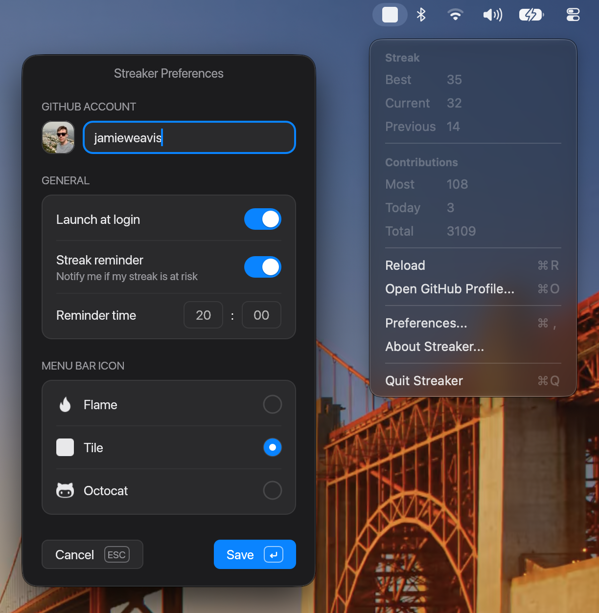

<div align="center">


# Streaker

Cross-platform GitHub contribution streak and statistic tracking menu bar application with reminder notification

[](https://github.com/jamieweavis/streaker/actions/workflows/build.yml)
[](https://github.com/jamieweavis/streaker/releases)
[](https://github.com/jamieweavis/streaker/releases)
[](LICENSE)


[**Download**](#download) · [Features](#features) · [Usage](#usage) · [Development](#development) · [Changelog](CHANGELOG.md)



</div>

---

## Features

- **Streak at a glance**: a menu bar icon that changes as you contribute, so you know where you stand without opening a browser
- **Contribution stats**: your best, current and previous streak, plus your most, today's and total contributions, one click away
- **Streak reminders**: an optional daily notification at a time you choose, sent only if your streak is at risk
- **Icon themes**: pick a **Flame**, **Tile** or **Octocat** menu bar icon
- **Launch at login**: set it once and forget about it
- **No sign-in needed**: just your GitHub username, no tokens or OAuth
- **Native and lightweight**: a single small Rust binary for macOS, Windows and Linux

## Download

Grab the latest build for your platform from the [**releases page**](https://github.com/jamieweavis/streaker/releases/latest):

| Platform | File |
| --- | --- |
| **macOS** (Apple Silicon & Intel, 11.0+) | `Streaker-<version>-macos-universal.dmg` |
| **Windows** (x64) | `Streaker-<version>-windows-x64-setup.exe` installer, or the portable `Streaker-<version>-windows-x64.exe` |
| **Linux** (x86_64 / aarch64) | `Streaker-<version>-linux-<arch>.deb`, or the `.tar.gz` binary |

> [!NOTE]
> The macOS app is ad-hoc signed but not notarised, so Gatekeeper will block it the first time. Right-click Streaker.app and choose **Open**, or run:
>
> ```sh
> xattr -dr com.apple.quarantine /Applications/Streaker.app
> ```

## Usage

1. Launch **Streaker**. It lives in your menu bar (or system tray), not the Dock or taskbar.
2. Click the icon and choose **Set GitHub username...**
3. Enter your username, adjust the settings to taste and hit **Save**.

That's it. Your stats appear in the menu and the icon updates as you contribute.

## Development

Requires stable Rust via [rustup](https://rustup.rs).

Common commands are in the [`justfile`](justfile). Install [just](https://github.com/casey/just):

```sh
brew install just        # or: cargo install just
```

Then run `just` to list them (`just run`, `just check`, `just install`, ...). Or use cargo directly:

```sh
cargo run                # run the app
cargo test               # run all tests
cargo clippy --all-targets
cargo build --release
```

Preferences are stored as JSON and logs are written to the platform's standard directories (e.g. `~/Library/Application Support/com.jamieweavis.Streaker` on macOS).

### Packaging

The crate carries [`cargo-bundle`](https://github.com/burtonageo/cargo-bundle) metadata:

```sh
cargo install cargo-bundle
cargo bundle --release   # run from the repo root: .app/.dmg on macOS, .deb on Linux
```


## Rust rewrite

Streaker v3 is a rewrite in Rust. Up to v2 it was an Electron app (see [v2.6.4](https://github.com/jamieweavis/streaker/tree/v2.6.4)), which meant shipping a whole copy of Chromium just to show one preferences window. The Rust version has the same features, with downloads up to 20x smaller and about a third of the memory use. See [the Rust rewrite doc](docs/rust-rewrite.md) for the motivation and the numbers.

## Related

* [Streaker CLI](https://github.com/jamieweavis/streaker-cli) - GitHub contribution streak & statistic tracking command line application with ASCII contribution graph
* [Contribution](https://github.com/jamieweavis/contribution) - GitHub contribution graph parser calculates contribution streak and commit statistics from a user's GitHub contribution graph page
