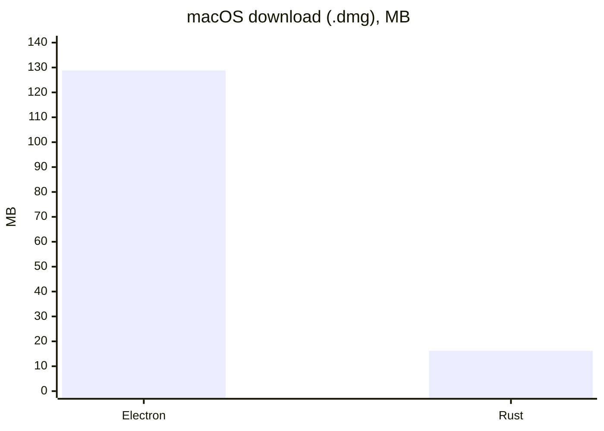
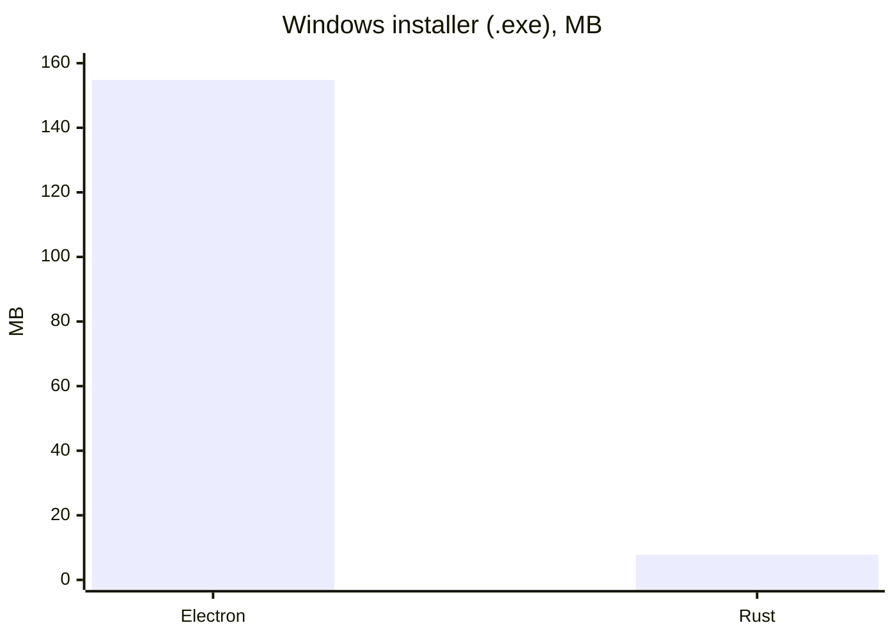
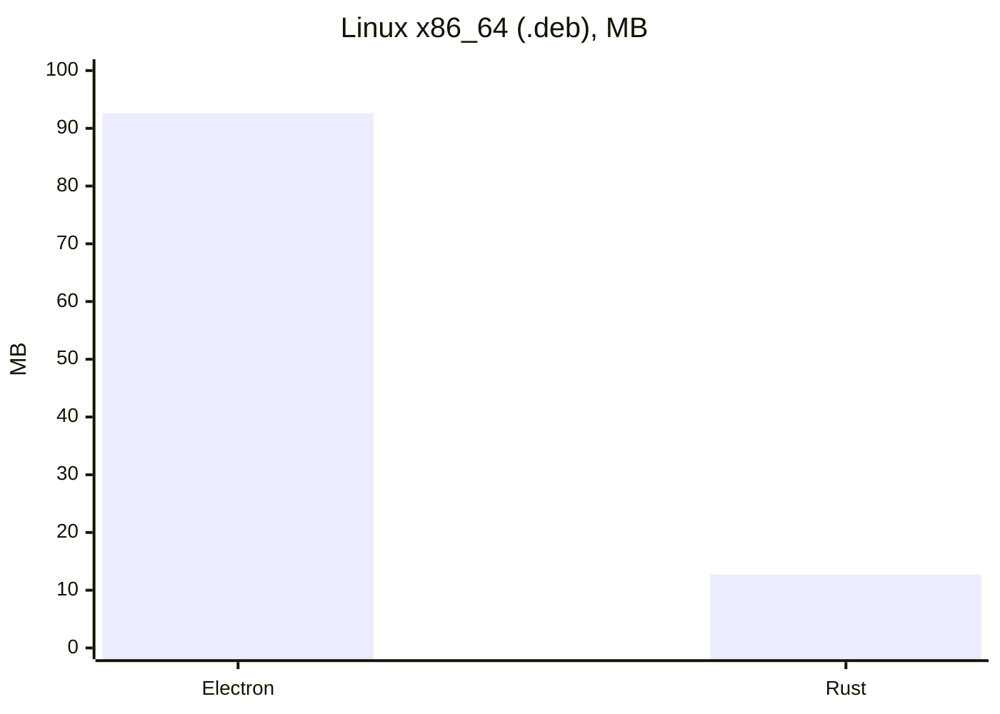
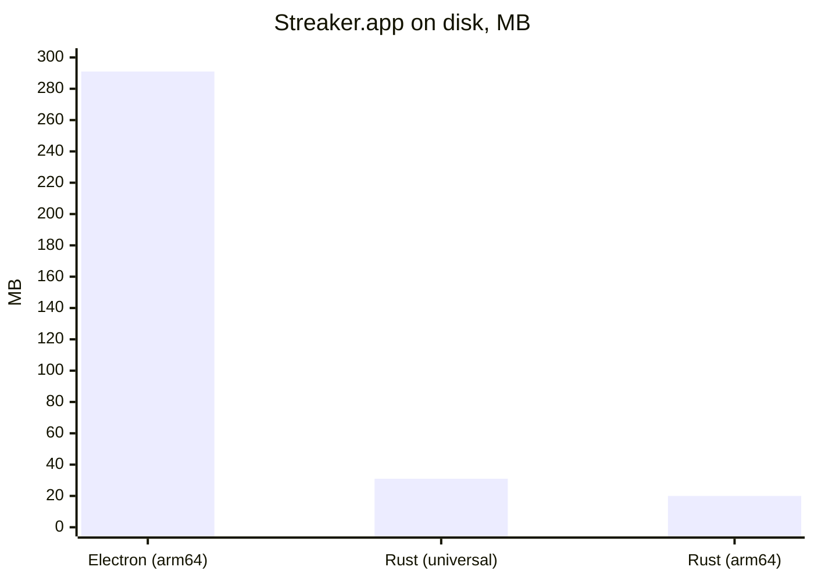
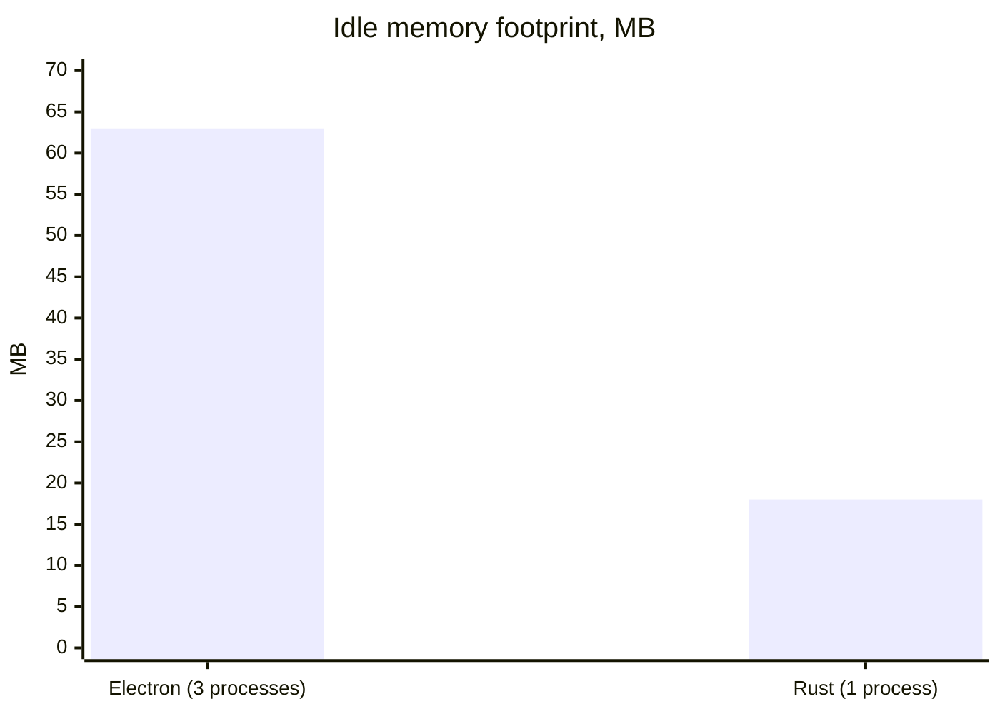
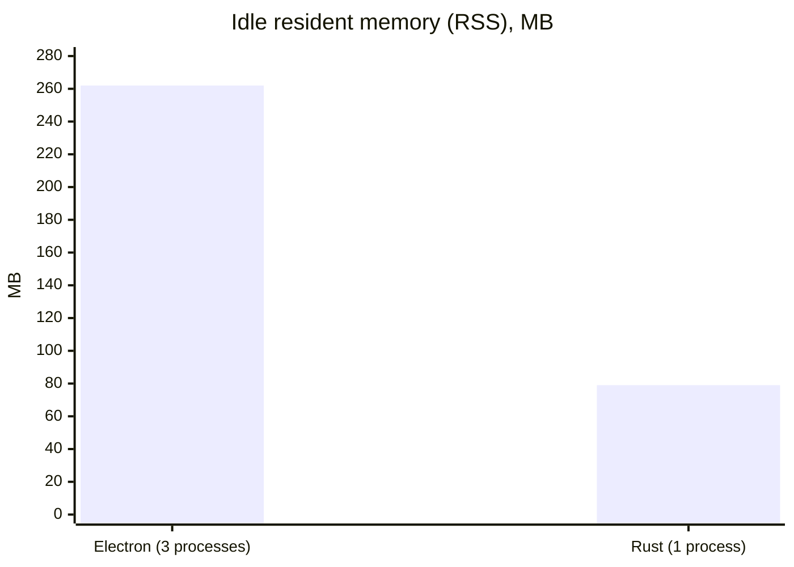

# Streaker: the Rust rewrite

> [!NOTE]
> Draft. Numbers are from a single machine and a single run each, so treat them as indicative rather than rigorous benchmarks.

Streaker v2 and earlier were built with Electron and TypeScript (the last Electron release is [v2.6.4](https://github.com/jamieweavis/streaker/tree/v2.6.4)). Streaker v3 is a ground-up rewrite in Rust that keeps the same features (menu bar streak icon, contribution stats, reminder notifications, icon themes, launch at login) while dropping the bundled Chromium runtime.

## Motivation

Electron isn't a good fit for an app like Streaker. It's a simple menu bar app that runs in the background. It shows an icon, a menu of stats and the occasional notification. The only real UI is a single preferences window, and to render it Streaker v2 had to ship a full copy of Chromium and Node.js.

That makes Electron bloated for this use case: every install carried a whole browser, several processes ran just to keep a tray icon alive, and the downloads were 90–155 MB. Rust lets Streaker be a single native binary that is fast, light on memory and up to 20x smaller, as the numbers below show.

| | Electron ([v2.6.4](https://github.com/jamieweavis/streaker/tree/v2.6.4)) | Rust (v3) |
| --- | --- | --- |
| Version compared | v2.6.4 | v3.0.0 |
| Language | TypeScript | Rust |
| UI | Electron 44 (Chromium + Node.js), Tailwind | Native tray via `tray-icon`, `egui` + `wgpu` preferences window |
| Packaging | Electron Forge | `cargo-bundle`, Inno Setup, custom DMG script |
| macOS build | Apple Silicon only | Universal (Apple Silicon + Intel) |
| Source lines (`src/`) | ~860 | ~3,400 |

The Rust version has more source code: work Electron and its npm packages did for free (tray handling, windowing, settings UI, HTML scraping, per-platform launch-at-login) is now explicit in the codebase.

## Download size

Release asset sizes from GitHub, in MB.

| Asset | Electron v2.6.4 | Rust v3.0.0 | Reduction |
| --- | --- | --- | --- |
| macOS `.dmg` | 128.8 MB (arm64) | 16.2 MB (universal) | ~8x |
| Windows installer | 154.8 MB | 7.8 MB | ~20x |
| Linux `.deb` (x86_64) | 92.6 MB | 12.7 MB | ~7x |
| Linux `.rpm` / `.tar.gz` (x86_64) | 101.3 MB (`.rpm`) | 10.8 MB (`.tar.gz`) | ~9x |

## Installed size (macOS)

The Electron app bundles a full copy of Chromium and Node.js. The Rust app is a single stripped binary plus icons, and the universal build carries both architectures and is still about a tenth of the size.

## Memory usage

Measured on macOS 27.0.1 (Apple M1 Pro), each app freshly launched and left idle in the menu bar for 15–20 seconds with the preferences window closed. *Footprint* is macOS's `footprint` figure (what Activity Monitor reports as Memory). *RSS* is resident set size from `ps`, which also counts shared system libraries.

| | Electron v2.6.4 | Rust (v3.0.0 build) |
| --- | --- | --- |
| Processes | 3 (main + 2 helpers) | 1 |
| Footprint | ~63 MB (45 + 11 + 7) | ~18 MB |
| RSS | ~262 MB | ~79 MB |
| Idle CPU | 0% | 0% |

The Rust footprint grows once the `egui`/`wgpu` preferences window has been opened (about 50 MB was seen after a long session with it opened), as the GPU surface and font atlas stay allocated. Freeing those when the window closes is a possible follow-up.

## Other differences

- **Platform support**: the Rust macOS build is universal, so Intel Macs are supported again. Linux ships `aarch64` builds as well as `x86_64`.
- **Updates**: the Electron app auto-updated in place via `update-electron-app`; the Rust app checks GitHub for a newer release and shows an **Update Available...** menu item linking to it, but doesn't install it itself.
- **Linux tray**: the Rust app uses the StatusNotifierItem protocol over D-Bus (`ksni`) with no GTK dependency; GNOME needs the AppIndicator extension.

## Method

- Download sizes: `gh release view <tag> --json assets` for the v2.6.4 and v3.0.0 releases.
- Installed size: `du -sh` on the extracted `.app` bundles (Electron from `Streaker-darwin-arm64-2.6.4.zip`, Rust universal from the v3.2.1 DMG and arm64 from a local `cargo bundle --release`).
- Memory: `footprint <pid>` and `ps -o rss` summed across every process belonging to the app.
